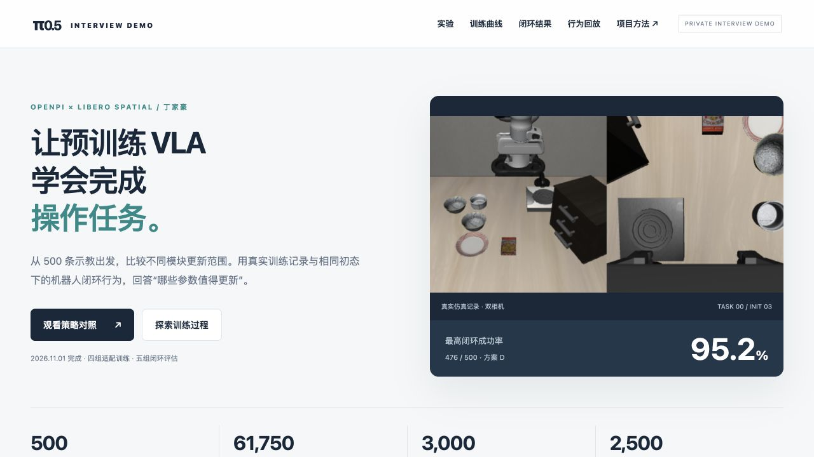
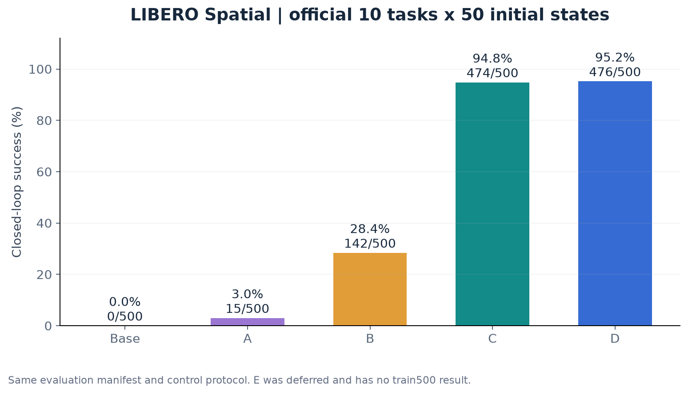
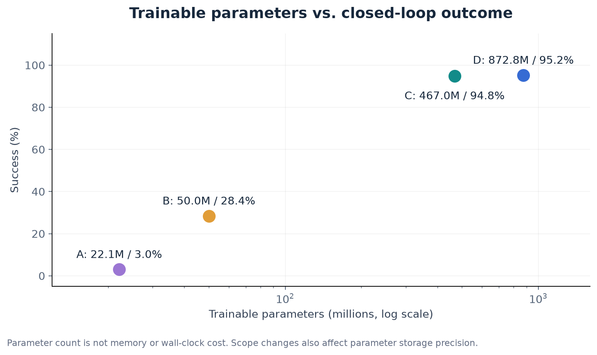
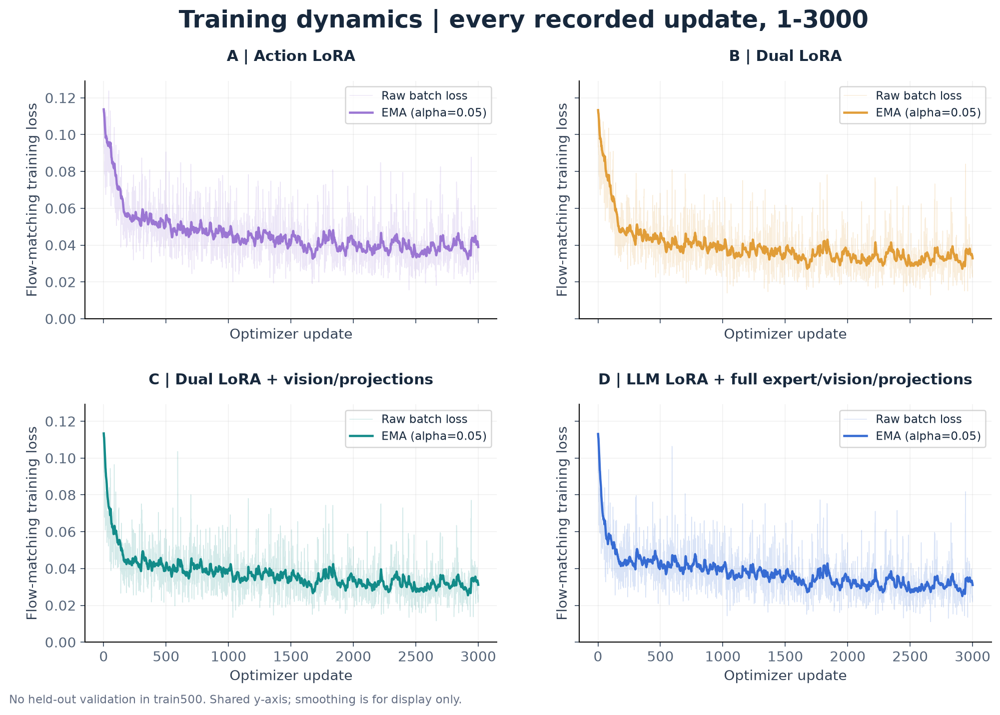

# π0.5 VLA · Interview Demo

**丁家豪｜预训练 VLA 的模块微调与机器人闭环评测**

在固定示教和训练预算下，比较动作专家、语言模块与视觉模块的更新策略，观察它们对机器人实际操作成功率的影响。

**500 条示教 · 10 个任务 · 3,000 次更新 / 方案 · 2,500 回合闭环评估**

## 建议浏览顺序

1. **[观看 60 秒概览](overview.mp4)**：同一初态下的真实机器人行为与核心结果。
2. **查看下方结果与训练曲线**：了解任务规模、模块更新范围和关键发现。
3. **打开交互 Demo**：下载本仓库 ZIP，解压后双击根目录 `index.html`；无需 GPU、无需安装依赖。

> 当前优先保持 **private**，面试官接受邀请后可在 GitHub 查看图表与视频。在线交互 Demo 的 Pages 发布配置已备好，private 状态不会发布；后续由所有者开放并启用 Pages，详见 [在线发布步骤](PUBLISH.md)。目前没有公网展示站点。

[](index.html)

## 核心结果

全部模型使用同一套官方 LIBERO Spatial 10 任务 × 50 初态与控制协议；每组 500 回合，运行错误数均为 0。

| 方案 | 更新范围 | 可训练参数 | 成功回合 | 成功率 |
|---|---|---:|---:|---:|
| Base | 原始 π0.5 基础权重，未微调 | 0 | 0/500 | 0.0% |
| A | 动作专家 LoRA | 22.12 M | 15/500 | 3.0% |
| B | 语言模块 + 动作专家 LoRA | 49.99 M | 142/500 | 28.4% |
| C | 双 LoRA + 视觉、外部投影等模块更新 | 466.96 M | 474/500 | **94.8%** |
| D | 语言模块 LoRA + 视觉、外部投影、动作专家原权重更新 | 872.77 M | 476/500 | **95.2%** |

M 表示百万参数，展示值保留两位小数。C 不是整模型全量微调；E 在当前这轮暂缓，没有本轮成绩。



## 三个发现

- **更新范围影响很大：**B→C 的成功率由 28.4% 提升至 94.8%，提高 66.4 个百分点。更新范围伴随部分参数精度变化，因此这是实际适配策略比较。
- **更多参数不一定带来同等幅度收益：**C 可训练参数约为 D 的 53.5%，总体成功数仅少 2 个。参数数量不等同于显存或训练耗时。
- **配对行为比均分更丰富：**C、D 共同成功 460 回合，C 独有成功 14 回合，D 独有成功 16 回合，共同失败 10 回合；两者各有反例。



## 训练过程

500 条训练示教形成 61,750 帧有效监督样本；global batch 32，每组 3,000 次优化器更新。记录了 A–D 共 12,000 次更新的 loss、学习率与梯度等信息。



淡线为每次更新的原始批次 loss，实线为 EMA（α=0.05）。本轮无留出离线验证，这些曲线不称作验证 loss。曲线来自已经完成的实验日志，没有为制作 Demo 重新训练。

[学习率与梯度](assets/charts/optimization.png) · [逐任务热力图](assets/charts/task-heatmap.png) · [配对成败](assets/charts/paired-outcomes.png) · [结果 CSV](results/summary.csv) · [逐步 loss CSV](results/loss.csv)

## 同一初态的真实行为

交互页面支持三路同时播放、切换模型、暂停、重置与播放速度控制。每段录像左侧为外部相机，右侧为腕部相机。

| 案例 | 初态 | 观看录像 |
|---|---|---|
| B 失败，C/D 成功 | task 0 / init 3 | [B](media/adaptation/B.mp4) · [C](media/adaptation/C.mp4) · [D](media/adaptation/D.mp4) |
| C 成功，D 失败 | task 0 / init 18 | [C](media/c_only/C.mp4) · [D](media/c_only/D.mp4) |
| 任务 5 中 D 成功，C 失败 | task 5 / init 6 | [C](media/d_only/C.mp4) · [D](media/d_only/D.mp4) |
| C/D 均失败 | task 0 / init 2 | [C](media/both_fail/C.mp4) · [D](media/both_fail/D.mp4) |

这些是条件筛选的行为案例，整体分数来自完整 500 回合；不以精选视频估计成功率。展示的是模型在仿真环境里自主执行的记录，不是示教动作重放，也不是在线实时推理。

## 项目工作范围

基于 OpenPI 的预训练模型和 LIBERO 环境，本项目完成示教时序对齐与动作块构造、模块更新范围实现、可恢复训练、固定初态闭环评测，以及逐任务与逐回合结果分析。

详细的数据、模型与评估机制见 [项目方法](METHODS.md)。完整业务工程与原始训练记录单独维护；本仓库专门用于展示，不包含训练环境、模型权重和原始示教。

## 交互页面使用方式

下载 ZIP 后直接打开 `index.html`。如果浏览器对本地媒体有限制，也可在解压目录运行：

```bash
python3 -m http.server 8769 --bind 127.0.0.1
# 打开 http://127.0.0.1:8769/
```

页面完全使用本地素材，无在线 API、CDN 或 GPU 依赖。

## 来源与边界

模型基于 [OpenPI](https://github.com/Physical-Intelligence/openpi)，任务基于 [LIBERO](https://github.com/Lifelong-Robot-Learning/LIBERO)。本项目没有从头预训练 π0.5，也不将上游官方适配权重的成绩归为自己的微调结果。

结果是同任务官方初态下的仿真评估，不代表未见任务泛化或真机部署能力。历史450条训练结果仅在明确标记的对照图中出现，不与当前500条训练主结果混合。精选媒体的初态与文件哈希见 [媒体清单](media-manifest.json)。
